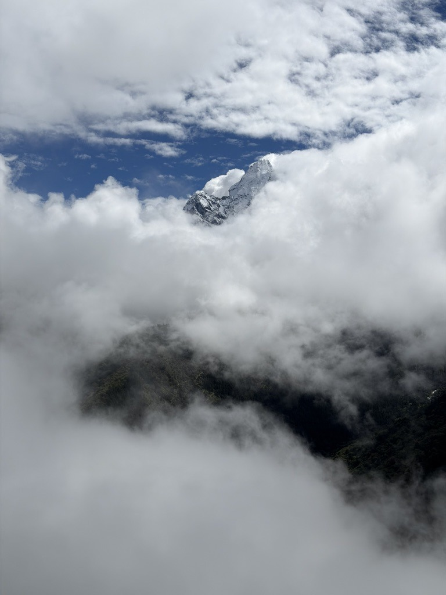
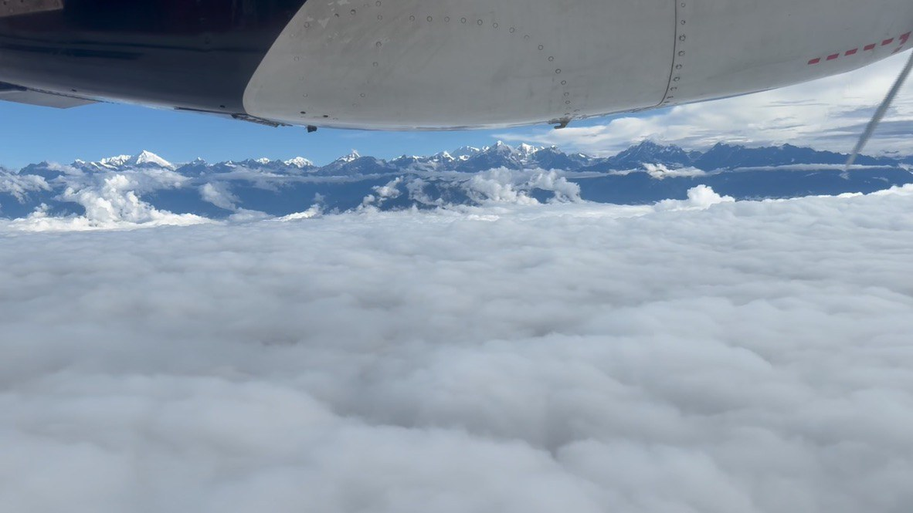
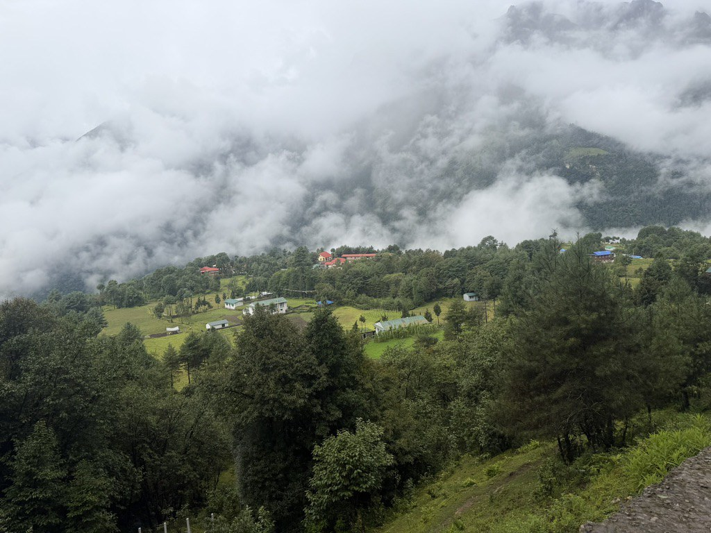
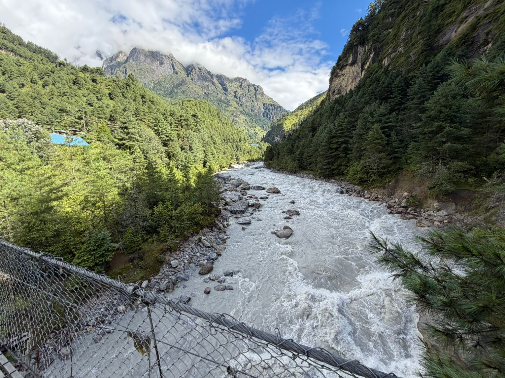
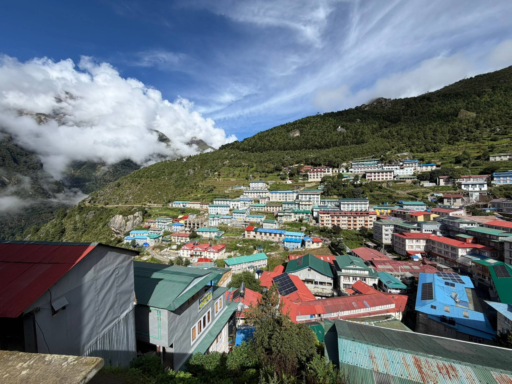
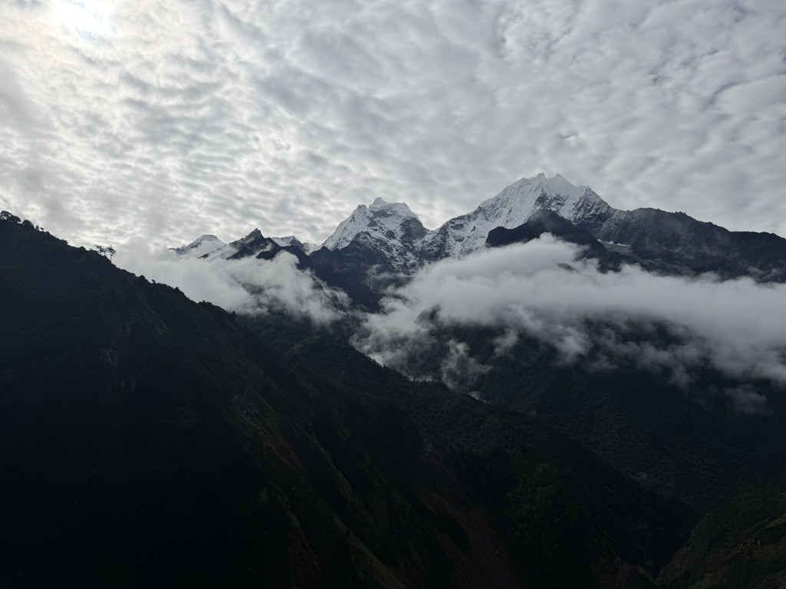
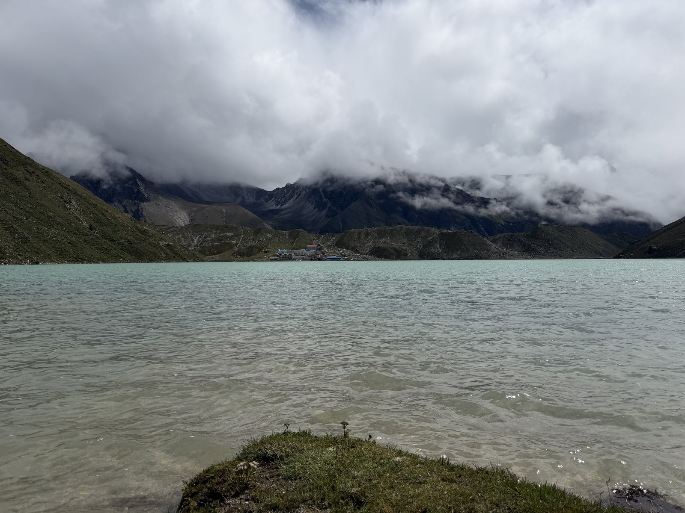
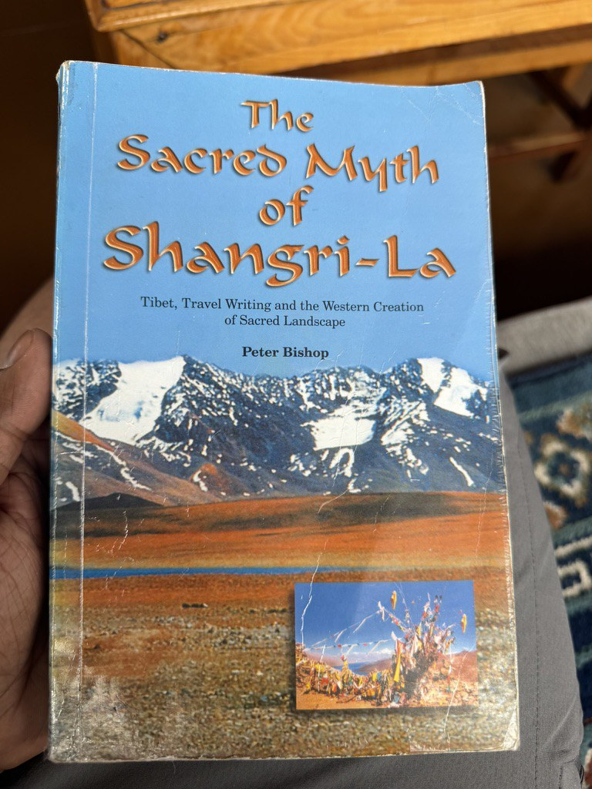
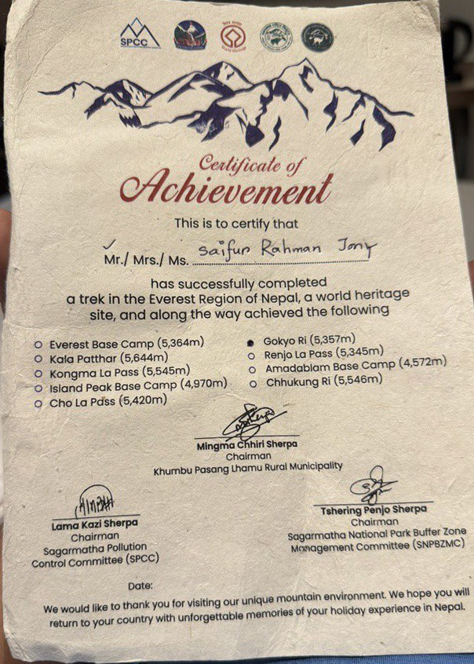

It has been almost three months since I attempted the Everest Base Camp trek. Time moves strangely. Three months have passed, yet when I think about those days, they still feel like yesterday.

Life since then has been busier than ever. I have multiple manuscripts under revision, and my own core PhD project has finally begun to take shape. I am enjoying this stage of my PhD more than I expected, partly because I can finally see myself applying skills and experiences I have gathered over the last ten years or so, some deliberately, and some for no apparent reason at all.

I have always had a habit of learning deeply about random things that have absolutely nothing to do with my academic work, or even with whatever I happen to be doing at the time. I learn them simply because I am curious. Usually, I do not expect that the knowledge will ever become useful, but mostly they do, in very surprising ways.

Last year, for example, I finished a fairly large book on chaotic systems.

There was no practical reason for me to read it. Chaos Theory had nothing to do with anything I had done before, and seemingly nothing to do with anything I was doing then. I had simply found myself wondering one day: How can dimensions be fractions instead of whole numbers? What does it actually mean for an object to have a fractal dimension? How can the UK have a finite area while the perimeter of the country along the Atlantic can, mathematically, become infinite? Why is it that no matter how far into or out of the Himalayas you zoom, the patterns seem somehow similar, the fractals repeating themselves?

I became mesmerized by Chaos Theory, particularly by the strange beauty of stability emerging from enormous amounts of chaos.

And then that was it.

Life moved on. I stopped thinking about chaotic systems and butterfly curves until last night, when I was reading an article and came across a sentence:

"Stochastic Gradient Descent (SGD) is a chaotic system."

Had I never learned anything about chaotic systems, that sentence would probably have meant nothing to me. Instead, everything I had read the year before suddenly began flowing back into my mind. I could see why SGD might behave like a chaotic system, and how a stable neural-network training process could emerge from something containing so much apparent chaos.

The feeling reminded me of titration in a high-school chemistry class.

You add one drop of reagent. Nothing happens.

Another drop. Nothing.

Ten drops. Twenty drops. Still nothing visible.

And then you add the twenty-first drop, and suddenly the entire solution changes color.

That final drop did not create the transformation by itself. It was no more responsible than the first ten or twenty drops. But when you added the first or second drop, you already knew it was not going to change anything immediately. You kept going because, somewhere down the road, another drop would arrive and complete what all the earlier ones had begun.

For me, that is the beauty of knowledge.

Whenever and wherever I find another drop of knowledge, I take it. I know it probably will not change anything for me at that moment, and I do not expect it to. But somewhere down the road of life, perhaps I will encounter that final drop of reagent that suddenly makes everything before it relevant.

So, I keep gathering knowledge wherever I find it.

And strangely enough, most of the practical knowledge I have gathered about living a happy and balanced life; about the purpose of my existence and my place within something much larger than myself; has come from the mountains.

That is why I feel the need to return to the Himalayas every year or two. I go there to discover another piece of knowledge.

It is not easy. In fact, while you are there, you may hate yourself for deliberately putting your body through so much suffering. It is physically exhausting, and along the way I have had more than a few near-death experiences. Yet what makes these journeys worthwhile is not simply the beauty you encounter while hiking.

It is the perspective you bring home. That perspective becomes another drop of reagent.

Life does not go easy on anyone, not even the happiest person you know. Everyone is fighting something, whether with the world or within themselves. Carrying the responsibilities of ordinary life every single day is difficult. Sometimes you become tired. Sometimes you feel like giving up.

Then I remember how small I am against the grandeur of the world. I remember the mountains. They stand there constantly, through every storm. Clouds may hide them for a while, but eventually the morning sun clears the sky, and there they are again, standing above everything.

  
  
Clouds can hide the mountain for a while, but it's always still there.

Life can be the same. You can become surrounded by clouds of uncertainty. The winter can be severe, and it can last far longer than you think it should. But eventually summer comes. Eventually the sun shines on those mountain peaks again. Your job is simply not to give up. You keep going through one day, and then another. I often draw these parallels between my own life and the life of a majestic mountain. And so, when I need to find some peace, I go hiking in the mountains. Which is exactly what I did three months ago.

I could have skipped everything above and started the story here. After all, this is supposed to be the story of my Everest Base Camp trip, not a philosophy of hiking.

But I am writing this memoir primarily for my future self, who might someday return to it. When he does, I want him to be able to understand my mental state at this particular point in my life, the rationale behind the way I was thinking.

Sometimes I wonder how much a person can really change in a year or two. Then I go back and read notes I wrote only a few years ago, and I am surprised by how different that person seems. I always end up wondering how I managed to change so much in such a short span of time.

So, my main audience here is that future version of me. Still, if somebody else happens to read this and finds even a little motivation for their own life in it, I would be more than honored.

My goal is not to write a day-by-day journal of my roughly fourteen-day trip. I already have that in my handwritten notebook. What I want to preserve here are the insights and perspectives the journey gave me.

With that preface, here I go.

This was my third trip to Nepal and my fourth trip to the Himalayas in roughly five years. But there was one important difference: for the first time, I was completely alone.

My first solo trip.

Oddly, being alone did not bother me much. By then I knew Nepal fairly well and understood how most things worked there.

On August 25, 2026, I flew from Dhaka, Bangladesh, to Kathmandu. It is a short flight, only about an hour. I spent the evening wandering around Thamel and finishing my last-minute shopping.

The next morning came another flight: a twenty-five-minute charter flight from Kathmandu to Lukla.

The planes are tiny, carrying only around ten to twelve passengers, and turbulence feels considerably more dramatic inside something that small. The aircraft can shake intensely.

I was fine with it.

After some of the near-death experiences from my previous trips, this felt like nothing.

Lukla is considered one of the riskiest airports in the world for landing. It sits in a valley along the route toward Everest and can be extremely difficult to see from above, particularly on cloudy days. But I loved the flight. From the plane, the Himalayas appeared incredibly close, unfolding in a panoramic view around us.

  
  
The Himalayas from the window on the flight into Lukla.

Early that morning, I landed in Lukla at 2,860 meters (9,383 feet).

And my first hiking day began immediately.

The route to Phakding was relatively relaxing, without much elevation gain. It was about a three-hour hike. The real problem was what I was carrying, and what I had become.

  
  
The way to Phakding.

My backpack weighed 15 kilograms (33 pounds).

Ironically, I was also about 15 kilograms, 33 pounds, above my usual body weight, thanks to a sedentary lifestyle and an enthusiastic consumption of sugar.

So my biggest question was simple:

Could I actually pull this off, alone?

I walked slowly and took many, many breaks. It was the end of the monsoon, and the weather remained mostly cloudy. Sometimes I was literally walking through clouds, shivering as I went, catching distant views whenever the weather allowed them.

It had been more than two years since I had done a hike this intense, and by the end of the day I was genuinely exhausted.

But experience had taught me something:

"It gets easier. It does get easier. All you have to do is do it every day."

Thank you, the random runner from BoJack Horseman.

So, I was not particularly worried. I found a pretty good lodge in Phakding and took a nap. Then, that evening, I went to the dining room for a cup of tea and heard about the flood. A severe flood had struck the Langtang Valley region of Nepal, roughly a hundred miles from where I was.

Initially, it did not bother me very much. Then I saw the videos.

Floodwater was washing away tall buildings as though they weighed nothing.

My entire hiking route, meanwhile, followed the Dudh Koshi River, which begins high above around Gokyo Lake and the Cho Yu Glacier. There were warnings that a Glacial Lake Outburst Flood, a GLOF, could occur in parts of the Himalayas, and the valley I was traveling through was among the regions under warning.

Watching videos on a screen was one thing.

Watching the people of Phakding become nervous about the possibility of a flood was something else entirely.

For the first time, I seriously reconsidered whether I should continue or turn around.

The isolation amplified everything. Hiking season was still about a month away, and apart from another guy, I was the only tourist in the entire village that day.

The next morning, I made a compromise with myself: I would continue, but I would hire a porter.

I found a young man, twenty-three years old, who was interested in carrying my bag for a fixed rate. Obviously, this helped considerably with my overweight situation, both the backpack and, well, the other 15 kilograms. :v

But reducing the load was not my only motivation.

Having a local person with me meant having someone who might recognize the warning signs of an imminent flood. Local people can read environmental cues that I am not trained to decipher, and they have their own networks through which information travels extremely quickly.

His presence gave me a little reassurance. I could relax while hiking, at least somewhat.

Like most forms of reassurance in life, however, it came at a price.

Traveling with local guides or porters can reduce your flexibility because they sometimes have incentives to bring you to their friends' lodges for lunch, dinner, or an overnight stay. Sometimes those lodges are good.

Many, many times, they are not.

When you are completely alone, you can eat wherever you want and sleep wherever you want. Fortunately, my porter was not particularly insistent about the places he suggested, so I retained a fair amount of freedom.

And we continued upward.

  
  
Crossing the Dudh Koshi river, every now and then.

The second day was intense.

For the first few hours, you hike toward the bottom of Namche Bazaar. Then comes the real work: roughly four hours of climbing all the way up to Namche Bazaar itself, at 3,440 meters (11,286 feet).

Namche is a centuries-old village that served as a central trading hub for Himalayan communities. People from surrounding regions were coming there to exchange goods even before the British Empire existed.

It was also the largest Himalayan village I had seen so far.

  
  
Namche Bazar, the largest Himalayan village I had seen so far.

After the punishment of Day Two, Day Three was supposed to be an acclimatization day.

The proper approach is to climb to a somewhat higher elevation during the day and then return to sleep lower. Doing this helps the body adapt to the reduced oxygen at altitude.

I had a different strategy.

I slept all day.

I am lazy in a very particular way. It is not that I am careless about my work; anyone familiar with how much of a perfectionist I can be already knows that. I simply enjoy finding the most efficient possible way of doing something so I can reclaim a few extra hours for sleeping or doing absolutely nothing.

So yes, I skipped the acclimatization hike and used the day to recover my energy instead.

Why spend energy I can save? :3

By Day Four, however, I had a more consequential decision to make.

My original plan had been to reach Everest Base Camp, EBC, at 5,364 meters (17,598 feet), then cross Cho La Pass at 5,420 meters (17,782 feet) and continue toward Gokyo Lake, around 5,357 meters (17,575 feet).

But the monsoon was still producing heavy rain. Cho La might be closed. If I followed the original route and then discovered that the pass was impassable, I might have to skip Gokyo altogether.

I really did not want to skip Gokyo.

So I reversed the plan.

I would visit Gokyo Lake first and then attempt Cho La from the other side toward Everest Base Camp. That way, even if I could not cross the pass, at least I would have seen Gokyo.

The choice was not particularly difficult.

EBC itself is essentially marked by a stone announcing that you have reached Base Camp. You do not even stay there; you eventually descend to sleep in a village at a lower elevation.

At Gokyo, however, you can stay directly beside the lake. You can walk along the water at night.

And lakes and rivers surrounded by mountains have always been my greatest weakness.

Obviously, I chose Gokyo.

Mountains, like life, and stock prices do not simply go up and up and up.

You climb for an hour, then descend for another hour and lose almost all the elevation you just fought to gain. Then you start climbing again.

From Namche Bazaar, I climbed toward Mong La Pass at around 4,000 meters (13,000 feet), only to descend again to Phortse Tenga, at 3,680 meters (12,073 feet), where I would spend the night.

  <video src="/images/travel/ebc/8.mp4" autoplay loop muted playsinline></video>
  
On the way to Mong La.

Phortse Tenga was tiny and sat directly beside the Dudh Koshi.

From my bed, I could hear the river flowing.

Normally, I love that sound.

That night, it made me nervous.

With the possibility of a flood still in my mind, every sound from the river reminded me how close I was to it. I wanted to get out of that zone as quickly as possible.

This was also the last place where I would have mobile signal. Beyond it, I would be completely out of network until I either returned or entered the Everest region.

I have often felt that I am not afraid of death, and I mean that quite literally.

But lying there beside the river, I realized something:

I did not want to die.

I have had the same realization during dangerous moments on previous trips. Strangely, those are the moments that have taught me most clearly how precious life actually is.

Sometimes, in ordinary life, we convince ourselves that death might somehow be a relief from living. Yet every time I have found myself close enough to genuine danger, my mind has told me the opposite.

Life is precious.

Something else touched me during those days. Almost everyone I knew, even people I communicated with perhaps once a year, texted or called to ask whether I had been affected by the flooding in Nepal.

And then there were my parents.

Knowing how easily both of them can panic about me and my safety, I had to reassure them that I was absolutely not in danger.

I am the danger, Skyler.

I also assured them that there was no river anywhere along my hike.

The Dudh Koshi River says hi.

Those were moments when I had to be strong not merely for myself, but for the people in my life, so that they could be okay.

Deep inside, of course, I was scared. But in the mountains, you cannot allow fear to take control of your mind. I kept reassuring myself that everything would be fine.

I have always handled fear and doubt this way. I tend to keep them inside rather than expressing them to anyone, and motivating myself has never been particularly difficult for me.

Psychological studies say that expressing yourself to someone you trust can relax the mind and give you confidence.

Apparently, I am the exception.

It is not that I do not trust people with my feelings. It is more that I do not expect everyone to understand what is happening in my life from my perspective, and neither do I think they necessarily should care, because most of the time I don't either.

Other people's pep talks have never motivated me very much.

My own do.

Perhaps, then, I have grown into my own self-sustaining chaotic system:

So much chaos inside, and yet, as a whole, my life is somehow stable.

  
  
Morning from Phortse Tenga — the anxious night behind me, the peaks clear again.

The next day I started toward Macchermo, at 4,470 meters (14,665 feet). It was my longest hike so far: around seven hours almost continuously.

As you climb higher, every ascent becomes more difficult because there is less oxygen available. But I still was not experiencing much trouble. I had learned some of the tricks of high-altitude hiking from previous journeys.

And once again, I was the only tourist in the entire area. There is something strange about having a place like that almost entirely to yourself.

Macchermo contains the only rescue point in the Gokyo region. I remember staring at it and thinking that perhaps a helicopter might generously offer me a free ride back.

I would happily run back to the city!

Stopping my daydream, I kept walking.

By then I had no mobile signal. No internet. No messages. No outside world.

I was free from everything.

And I was very, very high in the mountains.

From there, another 700 meters, roughly 2,300 feet, of elevation gain would finally bring me to the Gokyo lake system.

  
  
Gokyo Lake, with the village sitting right along its shore.

There are four Gokyo lakes. The first is relatively small; the second through fourth are roughly similar in size. Gokyo village and Gokyo Ri sit beside the third lake, called Dudh Pokhari.

Out of curiosity, I asked local people how deep the lake was.

They told me something around 43 meters, or 141 feet.

Looking at it, you would never guess. The water was so calm that its depth seemed almost impossible to comprehend.

By then it was my third consecutive day without internet. My only companion from the outside world was my offline Spotify playlist.

It was also the first day I truly experienced shortness of breath.

Once I climbed above 5,000 meters (16,400 feet), around Gokyo First Lake, breathing became something completely different.

You breathe hard.

Your lungs are working.

Your body is asking for air.

And somehow it feels as though nothing is actually entering your lungs.

I knew the solution was not to fight it. I simply needed to slow down.

So I did.

I gave myself an entire day off beside Gokyo Lake. I walked around the water. I watched yaks playing in the cold water. I scrolled through a rare book I found at the lodge, The Sacred Myth of Shangri-La.

The book fascinated me. It explored how, over the past few centuries, the Himalayas came to be imagined as a place of spiritual sacredness, and what these mountains had represented before that mythology took hold.

Of course, I photographed the book so I could find a copy once I returned.

  
  
The Sacred Myth of Shangri-La, the book I found at the lodge.

Then came another decision.

Would I attempt Cho La the following day and continue toward Everest Base Camp?

The hike itself was not extraordinarily intense, but crossing the pass required traveling over a glacier that had been subjected to an entire monsoon of rain and snow.

My porter was very much against the idea. He gave me many reasons not to cross. Naturally, I did not take them very seriously.

Then another solo hiker left Gokyo in the morning intending to cross Cho La toward EBC.

At 8 p.m., he returned to Gokyo. After an entire day, the snow and rain had prevented him from crossing the pass. That was enough evidence for me. I decided Cho La could wait for another trip.

The following morning, I began retracing the same route I had climbed.

Even under an almost clear sky, I still could not see the summit of Cho Yu, the sixth-highest peak in the world. The mountain was simply too massive. And I knew immediately that this alone was enough reason to return someday. Even if only to see the whole of Cho Yu, I will come back. I know that very well.

I made my way back toward Namche Bazaar and eventually Lukla. There is not much to say about the return journey. Like many return journeys, it felt less eventful than the way up.

From Lukla, I flew back to Kathmandu and spent another two days there.

I mostly did nothing. But I had one mission. I searched the bookstores of Thamel for The Sacred Myth of Shangri-La. After going through all of them, I finally found a bookstore with exactly one copy. I am glad I got it.

I bought a few other books as well, additions to the future library I plan to build someday. Then I flew back to Dhaka. Two weeks later, I returned to the United States and resumed work on my PhD. The trip had refreshed me. It restored some of my energy and gave me the motivation to begin working again.

  
  
The certificate, Gokyo Ri marked among the achievements of this trip.

More than anything, I was glad I had managed to make the journey at all, even while my life was becoming so busy and demanding. I believe we can always find time for the things we truly love, if we genuinely want to. I know I will always find time for the mountains, no matter how busy my life becomes. This is the most adventurous part of my life, and I intend to keep returning.

I also know there is real risk in that promise.

Did you know that around 300 dead bodies are scattered across Mount Everest? Some have been there for nearly a hundred years. Some have never been discovered and remain hidden. Others are visible to climbers on their way up the mountain but cannot be recovered because retrieving them would put more lives at risk. When I looked toward Everest and thought about those roughly 300 motivated souls, a cold wind seemed to move through my entire body.

One day, on one of these trips, I may not be as lucky. I may not return.

When Nirmal "Nims" Purja set out on his adventures, it was as though he always understood that his life might someday end somewhere in the mountains. Perhaps he did not imagine Broad Peak specifically, but he understood the risk.

I have never climbed at the elevations he did. Perhaps someday I will try. But I understand the underlying motivation.

When you love the mountains, you understand that the love comes with risk.

And still, you return. Maybe that is another form of chaos: knowing the danger, knowing the uncertainty, knowing that the path will rise and fall and that sometimes the clouds will completely hide what lies ahead, and continuing anyway.

Because somewhere along the way there will be another drop of knowledge.

Another piece of yourself you did not know before.

Another mountain hidden behind the clouds.

And perhaps, one day, one final drop will fall into place and make all the others meaningful.

Until then, I will keep collecting them.
